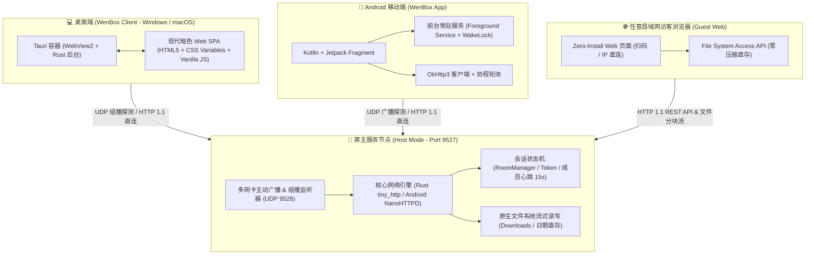
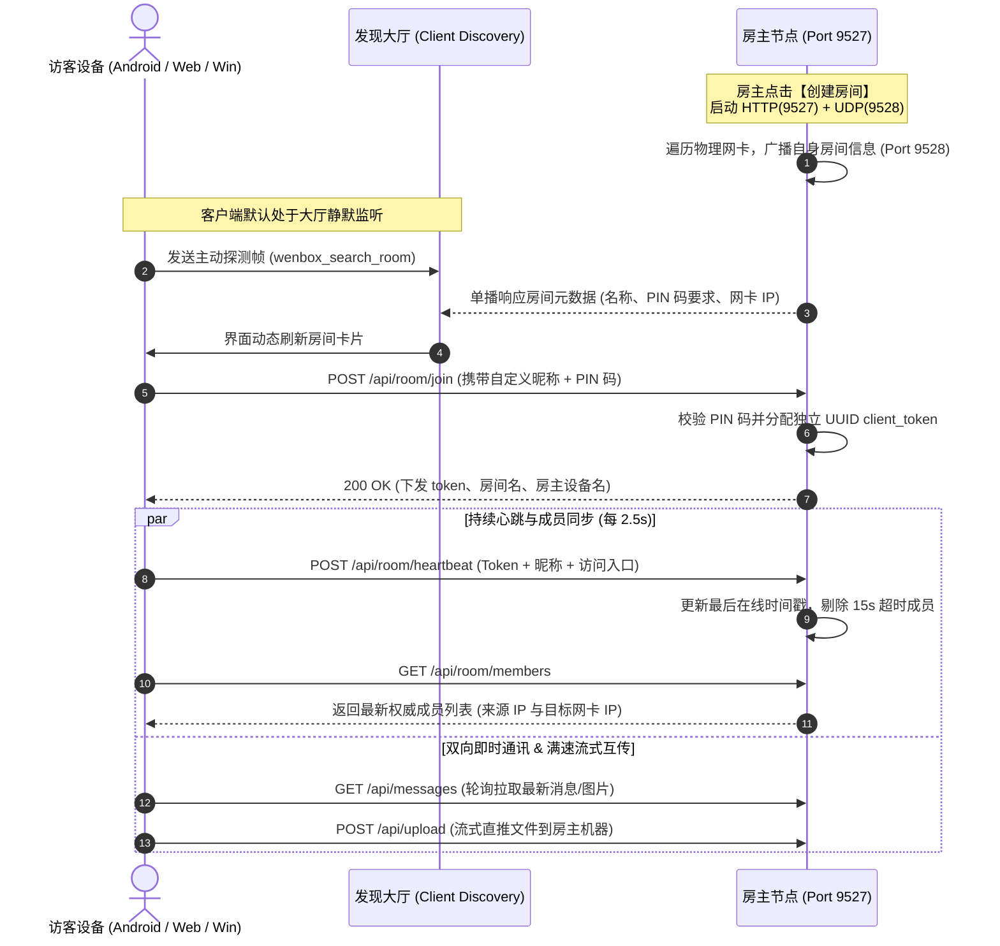

# WenBox (文盒) - 跨平台局域网高速传输与全能多端百宝箱

<p align="center">
  
</p>

<p align="center">
  <b>专注于局域网跨平台高速文件双向互传、即时通讯协作与实用开发辅助的轻量全能工具箱</b><br>
  零云端依赖 · 100% 局域网传输 · 多网卡并发穿透 · 访客免安装秒用
</p>

<p align="center">
  <a href="https://github.com/WendelYu/WenBox/releases"></a>
  
  
  
  
  <a href="LICENSE"></a>
</p>

---

## 📖 项目简介

**WenBox (文盒)** 是一款为现代局域网协作、移动办公以及工程开发量身打造的跨平台多端全能工具箱。

在日常办公与团队局域网协作中，我们经常面临如下痛点：
1. **传输受限**：微信/QQ 发送大文件被压缩、限速、或者需要频繁登录账号；
2. **多网卡环境失效**：电脑同时插网线并连 Wi-Fi，或开启虚拟机/热点时，常见局域网传输软件经常“找不到对方”；
3. **访客门槛高**：给同事或客户传文件时，必须要求对方也下载安装对应客户端；
4. **整理繁琐**：报销发票、现场照片、测试文档需要手动解压、命名建文件夹；
5. **开发工具分散**：查 Cron 表达式、格式化 JSON、进制转换需要在各类网页广告插件间来回切换。

**WenBox** 采用**自研房间制拓扑架构**与**多网卡独立并发探测协议**，彻底解决以上所有痛点。不管是 Windows / macOS 桌面端、Android 手机端，还是任意未安装客户端的浏览器设备（手机、平板、Linux），均能实现秒级发现、满速传输、即时文字/截图交流与高效开发辅助。

---

## 🏗️ 整体技术架构图

### 1. 系统多端拓扑架构



---

### 2. 房间发现与 P2P 直连时序图



---

## 🌟 核心功能模块

### 1. 🏠 创新房间制局域网传输架构

- **默认客户端发现大厅 (Client Discovery Mode)**：
  - 启动后**默认处于客户端大厅**，仅监听网络广播，不占用服务端口、不广播无用数据、零资源消耗。
  - **多网卡智能并发绑定与主动探测**：后台同时枚举并绑定所有可用物理/虚拟网卡（Wi-Fi、以太网有线口、热点网卡），结合子网定向广播、`255.255.255.255` 全局广播与 `239.255.255.250` 组播。支持双向 Ping-Pong 探测帧（`wenbox_search_room`），彻底解决插网线+连无线多网卡环境下“搜不到房间”的行业痛点。
- **打开软件即自动建房 (零操作上手)**：
  - 软件启动后自动创建一个**免密房间**并立即对外广播，无需点击任何按钮；
  - 现场其他设备通过 IP 访问后在发现大厅一键加入，打开即可互传文件与报错信息。
- **一键建房变身服务端 (Host Mode)**：
  - 任意设备点击**【➕ 创建房间】**即可变身服务端，自由设置房间名称与入房 PIN 码（支持留空免密）；
  - 支持保存多个**常用密码房**配置 (房间名 + PIN)，创建时可一键填入，随时切换不同密码房；
  - 创建后本机**动态激活为服务端主机 (Port 9527)**，并向所有网卡广播宣告自身房间。
  - 主机控制台提供直观的**【📱 扫码秒进】二维码**（纯前端本地生成，完全离线可用）、**【📋 复制入房直链】**、**【👥 实时在线成员与访问 IP】**与**【⏹️ 解散房间】**操作。
- **自定义入房昵称与真实 IP 追溯**：
  - 加入房间时支持手动输入个性化昵称（如 `研发-小张`、`现场工程师`）。
  - 房间内所有成员统一以 **`昵称 (IP)`** 格式清晰展示，谁在线、谁发的消息一目了然。
- **双向互传与局域网千兆满速**：
  - 双方进入房间后即建立端到端直连：客户端可浏览并下载房主分享的文件，也可将手机/电脑端文件直接推送到对方电脑的 `Downloads/WenBox/` 目录。
  - 采用原生流式 HTTP 传输，无任何协议封包损耗，轻松跑满千兆 Wi-Fi (100MB/s+)。

---

### 2. 💬 局域网即时通讯与在线协作

- **全平台自研原生/Web 优雅弹窗**：
  - 彻底告别系统原生丑陋且具有阻塞风险的 `alert()` / `confirm()`，全平台统一采用自主设计的深色卡片式对话框，操作流畅丝滑。
  - 解散房间、退出房间均具备二次防误触确认机制。
- **实时在线成员与访问网卡透视**：
  - 顶部清晰展示当前**实时在线人数**（如 `👥 在线: 3 人`），点击即可呼出**【👥 房间在线成员与 IP】**弹窗。
  - 支持清晰显示**客户端设备真实 IP** 与 **命中的房主服务网卡 IP**，并支持一键复制。
- **即时互发消息与富文本气泡**：
  - 消息气泡自动带上发送端设备标签、昵称与发送者 IP（如 `[💻 Windows] (192.168.1.100) • 14:32:05`）。
  - 支持 **Ctrl+V 粘贴截图** 直接发送图片并全屏预览，支持拖拽与选择文件发送快传卡片。
- **移动端前台保活与桌面防雪崩自愈**：
  - **Android 端**：配置无超时前台保活服务、不间断 WakeLock 与低延迟 Wi-Fi 锁，手机息屏时网络不中断、服务不被杀。
  - **Windows 桌面端**：引入请求防雪崩队列锁（In-flight concurrency guard）与 2.5s 网络超时熔断机制，即便网络断开或房主关闭也绝不崩溃死锁。
  - 房主解散房间时向所有网卡广播下线通知，客户端平滑断开并自动返回大厅。

---

### 3. 📁 灵活的日期归档直存模式 (照片/文档/报销整理利器)

- **免压缩包、零解压**：基于现代浏览器标准 File System Access API，无需打包与反复解压。
- **自定义归类主题**：
  - 在电脑端指定存放总根目录，可自由输入文件夹后缀（默认 `报销`，可自由自定义为 `发票`、`现场照片`、`文档归档` 或留空）。
  - 程序自动在所选根目录下创建当天格式的子文件夹（例如 `2026-09-24_现场照片/`）。
  - 上传的文件直接整齐存入该日期目录下，一步到位。

---

### 4. 🛠️ 工程师与开发者全能百宝箱

#### 4.1 📋 JSON 格式化与语法校验
- **多层级美化排版**：支持 2 空格 / 4 空格层级美化排版，精准标红语法错误与行列位置。
- **单行精简压缩**：一键剔除多余空白与换行，便于复制到报文或配置文件中。
- **模板与快捷操作**：内置丰富示例模板，支持一键全选复制与清空。

#### 4.2 ⚙️ 多进制秒级联动互转 (HEX / DEC / BIN / OCT / ASCII)
- **秒级多向联动**：在 16 进制 (HEX)、10 进制 (DEC)、2 进制 (BIN)、8 进制 (OCT)、ASCII 文本任意框内输入，其余进制秒级自动联动换算。
- **优雅分段排版**：HEX 自动按两两字节分组（如 `1A 3F`），BIN 自动按 4 位分组，支持单独一键复制各进制结果。

#### 4.3 ⏱️ Cron 表达式全能工作台
- **30+ 常用与高级调度模板**：
  - 秒级与分钟级高频调度（`* * * * * ?`、`0/2 * * * * ?`、`0 0/2 * * * ?`、`0 */5 * * * ?` 等）；
  - 每天与特定时间段调度（整点、每天 10:15、每天 10点/14点/16点、14点每分钟、14点至14:05等）；
  - 工作日与周周期调度（工作日 09:00、工作日 18:00、每周一 10:00、周三中午 12:00、9点至17点每半小时等）；
  - 月度/季度/年度高级规则（每月 1 日、每月 15 日、每月最后一天 `0 0 0 L * ?`、每月第3个星期五 `0 15 10 ? * 6#3`、每季度首日 `0 0 0 1 1,4,7,10 ?`、历史指定年份 `0 15 10 * * ? 2005` 等）。
- **自然语言通俗大白话反解**：智能反解 Quartz / Linux 5~7 字段表达式，秒懂执行周期。
- **未来时刻精确推演**：精准推演并列出接下来的 **5 次预计触发时刻**（精确到秒）。

---

## 💻 技术栈

| 模块 | 技术方案 | 优势 |
| :--- | :--- | :--- |
| **桌面端核心 (Windows / macOS / Linux)** | Rust + Tauri 1.5 + tiny_http | 编译产物仅 **3~5 MB**，内存占用仅 **~15MB**，极速启动 |
| **移动端 (Android)** | Kotlin + Android Jetpack + OkHttp3 | 原生 Android 8.0+ 支持，前台常驻保活，息屏低功耗 |
| **前端展现层 (Web SPA)** | HTML5 + CSS3 (Variables) + Vanilla JS | 零框架依赖、加载速度 < 50ms，跨浏览器零兼容包袱 |
| **局域网协议层** | UDP 组播/多播广播 + HTTP/1.1 流式传输 | 跨子网多网卡穿透，无需互联网，跑满千兆硬件上限 |

---

## 📂 源码目录结构

```text
WenBox/
├── README.md                     # 项目完整说明文档与架构设计
├── package.json                  # 项目依赖与版本管理配置
├── src-tauri/                    # 桌面端 (Rust / Tauri, Windows / macOS 通用)
│   ├── Cargo.toml                # Rust 依赖与版本定义
│   ├── tauri.conf.json           # Tauri 桌面应用窗口与构建配置
│   └── src/
│       └── main.rs               # Rust 核心后端 (HTTP 服务、UDP 多网卡广播、聊天与文件 API)
├── app/                          # Android 原生客户端 (Kotlin)
│   ├── build.gradle              # Android 模块级编译脚本
│   └── src/main/
│       ├── AndroidManifest.xml   # Android 权限与服务声明
│       ├── java/com/landrop/     # Kotlin 原生源码 (Activity/Fragment/Server/CronHelper)
│       └── assets/web/           # 共享 Web SPA 资源 (纯前端 HTML/CSS/JS)
│           ├── index.html        # 统一 UI 视图层
│           ├── app.js            # 核心业务交互、即时通讯、Cron 解析器
│           └── style.css         # 质感暗色主题样式
└── .github/workflows/            # GitHub Actions CI/CD 流水线 (全自动打包发布)
    ├── release.yml               # 打 Tag 自动编译发布 Android APK & Windows EXE
    ├── build-apk.yml             # Android 独立构建验证
    └── build-windows-exe.yml     # Windows 独立构建验证
```

---

## 📦 下载与自动发布 (Releases)

本项目配置了完整的 **GitHub Actions CI/CD** 全自动多平台流水线：

每次提交版本标签（例如 `v1.3.0`），云端流水线将全自动交叉编译并发布至 [GitHub Releases](https://github.com/WendelYu/WenBox/releases)：

| 平台 | 格式 | 说明 |
| :--- | :--- | :--- |
| **Android** | `WenBox-Android.apk` | 支持 Android 8.0+，纯局域网免流量直传，前台服务稳定保活 |
| **Windows** | `WenBox-Windows-x64.exe` | **超轻量独立单文件**，仅 **3~5 MB**，双击即开，内置完整服务 |
| **Windows** | `WenBox-Windows-Installer.exe` | 带安装向导与开始菜单快捷方式的标准安装程序 |
| **任意设备** | Web 浏览器 | 手机/平板/Mac/Linux 浏览器直接访问 `http://[房主IP]:9527` 即可使用全部功能 |

---

## 🛠️ 本地编译构建指引

### 1. Android 端编译
- 使用 **Android Studio** 打开工程根目录；
- 等待 Gradle 同步完成；
- 菜单栏点击 **Build -> Build Bundle(s) / APK(s) -> Build APK(s)**；
- 编译产物位于：`app/build/outputs/apk/debug/app-debug.apk`。

### 2. 桌面端编译 (Rust / Tauri，面向 Windows)
- 前置依赖：
  - [Rust 环境](https://rustup.rs/) (Stable 1.70+)
  - [Node.js](https://nodejs.org/) (v18+)
- 编译命令：
  ```bash
  # 安装依赖
  npm install

  # 编译生成超轻量单文件 exe 及安装包
  npx @tauri-apps/cli build
  ```
- 编译产物位于：`src-tauri/target/release/wenbox.exe`。

---

## 🔒 安全与隐私声明

- **100% 局域网传输**：WenBox 所有数据传输与通讯均在设备所在局域网内直接点对点进行；
- **零云端依赖**：不依赖任何外部中心化服务器或云存储；
- **零数据收集**：无任何遥测（Telemetry）、无统计上报、无用户跟踪；
- **访问控制**：房主建房可自由设置 PIN 码，桌面端 / Android 端 / Web 服务端三端均强制校验房间令牌，文件列表、下载与上传接口对未授权设备一律拒绝；只有输入正确密码或扫码授权的设备方可连入。

---

## 📄 开源许可证

本项目遵循 [MIT License](LICENSE) 开源协议。  
欢迎提交 Issue 与 Pull Request 共同建设！

Crafted with ❤️ by [Wendel](https://github.com/WendelYu)
