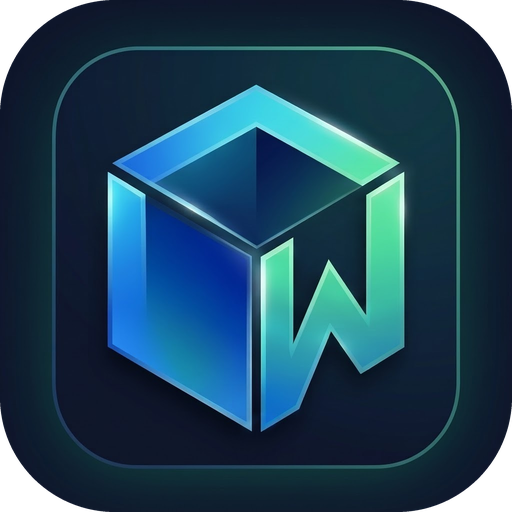
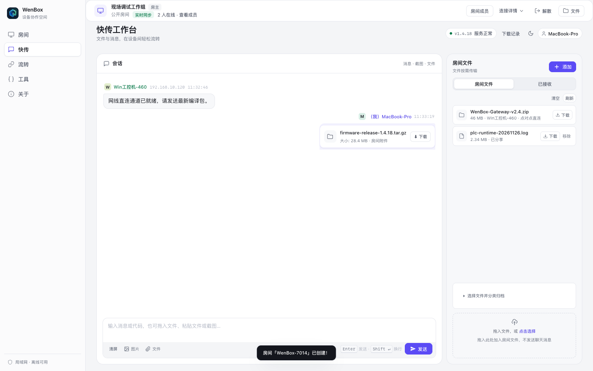
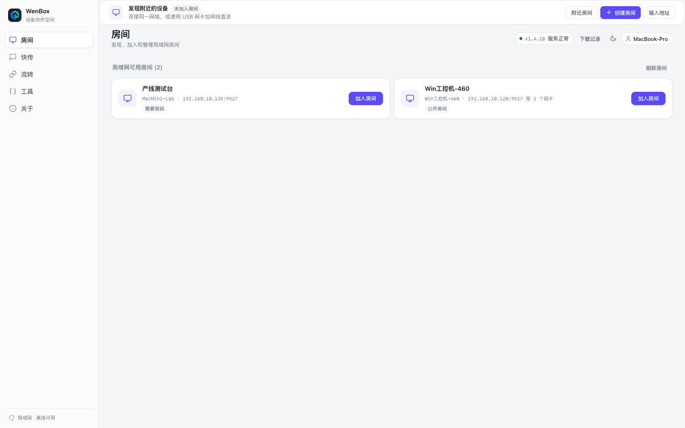
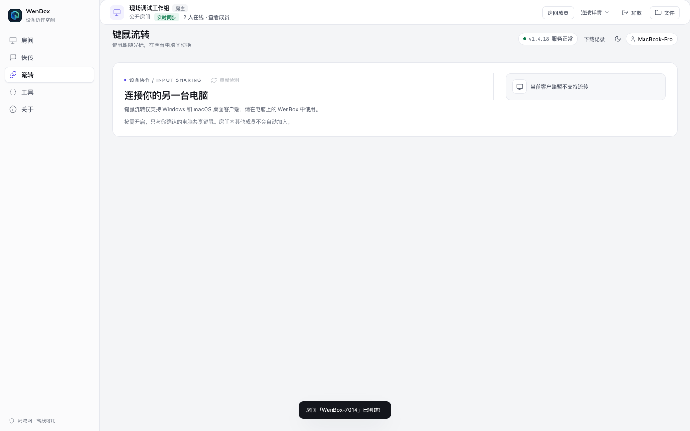
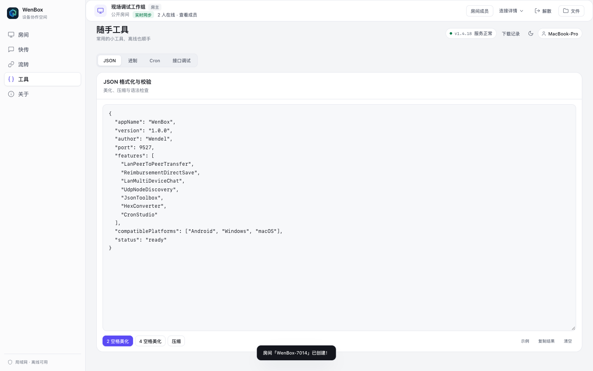

<div align="center">



# WenBox

**局域网零副本快传 · 跨设备键鼠流转 · 离线工程师百宝箱**

无需云盘、无需账号、无需公网 —— 一条网线或同一局域网，让 Windows、macOS、Android 与浏览器瞬间互联。

<p>
  <a href="https://github.com/WendelYu/WenBox/releases/latest"></a>
  <a href="https://github.com/WendelYu/WenBox/releases"></a>
  
  
  
</p>

<p>
  <a href="#-为什么选择-wenbox">核心亮点</a> ·
  <a href="#-界面预览">界面预览</a> ·
  <a href="#-平台与能力一览">支持平台</a> ·
  <a href="#-快速上手">快速上手</a> ·
  <a href="#-下载与安装">下载安装</a> ·
  <a href="#-隐私与安全">安全边界</a> ·
  <a href="#-本地开发与构建">本地开发</a>
</p>

<br />



</div>

---

## ✨ 为什么选择 WenBox？

WenBox 最初诞生于真实的**内网互传**与**工控现场调试**场景：改代码、打包、拷 U 盘、拔插、再拷贝……循环往复。我们希望两台电脑之间只需接入同一局域网，甚至**只插一根 USB 网卡 + 网线**，就能长期保持互联——传文件、发截图、共享键鼠、调试接口一站搞定。

<table>
  <tr>
    <td width="50%" valign="top">
      <h3>🚀 局域网点对点零副本直传</h3>
      桌面端直接读取源文件流式发送，支持 <b>1 跳点对点直连</b>（优先 USB / 网线直连网卡），不经过云端也不在发送端产生多余临时副本；下载实时展示进度条、传输速率（<code>MB/s</code>）与剩余时间，不可直连时自动无感回退房主中转。
    </td>
    <td width="50%" valign="top">
      <h3>🖱️ Mac ↔ Windows 键鼠流转</h3>
      一套键鼠在两台电脑间丝滑穿梭：支持双机配对自动重连、四方向屏幕布局、独立指针/滚轮速度、自定义修饰键映射与默认开启的双向文本剪贴板同步；Windows 安装版内置系统级输入服务，支持管理员窗口与 UAC。
    </td>
  </tr>
  <tr>
    <td width="50%" valign="top">
      <h3>🔌 无网口 / 无 Wi-Fi 也能直连</h3>
      专为离线与工控现场优化：两台电脑通过 <b>USB 转网口适配器 + 网线</b>直连（自动发现 <code>169.254.x.x</code> 链路），无需路由器或共享网络；自动合并多网卡重复房间，房主离线自动解散，成员状态实时推送。
    </td>
    <td width="50%" valign="top">
      <h3>💬 聊天快传与分类归档</h3>
      支持文本消息、代码高亮、多文件队列、粘贴系统文件与聊天框直接展示截图缩略图；桌面端支持按自定义目录与日期前缀批量分类归档，同名文件自动安全编号不覆盖。
    </td>
  </tr>
  <tr>
    <td width="50%" valign="top">
      <h3>🧰 离线工程师百宝箱</h3>
      无需联网即可使用的随手工具集：内置 <b>HTTP 接口调试</b>（支持 Java VTO/DTO 转 JSON 与 cURL 导入）、<b>JSON 格式化/压缩</b>、<b>多进制 / ASCII 转换</b> 与 <b>Cron 表达式预演</b>。
    </td>
    <td width="50%" valign="top">
      <h3>🔄 全端覆盖 &amp; 应用内自动更新</h3>
      提供 Windows、macOS、Android 客户端及浏览器免装访问；桌面端内置「关于 → 检查更新 / 自动检查更新」，macOS 从 DMG 拖入「应用程序」完成首次安装后，后续版本可直接下载校验并自动覆盖重启，免去每次手敲隔离命令。
    </td>
  </tr>
</table>

---

## 📸 界面预览

<table>
  <tr>
    <td align="center" width="50%">
      <br />
      <sub><b>发现大厅</b> · 多网卡自动聚合 · 免密 / 密码房一键加入</sub>
    </td>
    <td align="center" width="50%">
      <br />
      <sub><b>快传工作台</b> · 聊天发图 · 实时进度速率 · 分类归档</sub>
    </td>
  </tr>
  <tr>
    <td align="center" width="50%">
      <br />
      <sub><b>键鼠流转</b> · 四方向布局 · 速度与修饰键映射 · 剪贴板同步</sub>
    </td>
    <td align="center" width="50%">
      <br />
      <sub><b>随手工具</b> · 接口调试 · JSON · 进制转换 · Cron 预演</sub>
    </td>
  </tr>
</table>

---

## 🖥️ 平台与能力一览

| 平台 | 运行形式 | 局域网快传 & 聊天 | 点对点直连 | 键鼠流转 & 文本同步 | 应用内自动更新 |
| :--- | :--- | :---: | :---: | :---: | :---: |
| **Windows 10 / 11 (x64)** | 安装版 (`Installer.exe`) | ✅ | ✅ | ✅（支持管理员窗口 / UAC） | ✅（自动拉起安装升级） |
| **Windows 10 / 11 (x64)** | 免安装版 (`Portable-x64.exe`) | ✅ | ✅ | — | ✅（自动替换并重启） |
| **macOS 12.3+** | 通用安装包 (`universal.dmg`) | ✅ | ✅ | ✅（要求 macOS 14+） | ✅（SHA-256 校验 · 免隔离重启） |
| **Android 8.0+** | 原生 APK（Kotlin） | ✅ | 房主协调 | — | — |
| **Web 浏览器** | 访问 `http://房主IP:9527` | ✅ | 房主协调（≥64MB 流式写盘） | — | 随房主自动同步 |

---

## ⚡ 快速上手

### 场景一：同一局域网 / Wi-Fi 互传

1. 两台设备接入同一局域网，打开 WenBox（桌面端启动后自动开启本机服务并建立默认房间）。
2. 在「房间」页点击发现到的设备加入（多网卡设备已自动合并，加入他人房间时会自动解散本机房间）；手机或未装客户端的电脑直接扫码或访问 `http://房主IP:9527`。
3. 拖入文件、选择文件，或直接 `Ctrl/⌘ + V` 粘贴截图/系统文件即可开始传输。

### 场景二：无 Wi-Fi / 无空闲网口 —— USB 网卡 + 网线直连

```text
开发电脑 ── [USB-A / USB-C 转 RJ45 网卡] ══════ 网线 ══════ [现场电脑网口 / USB 网卡]
```

> **提示**：这里使用的是 **USB 转以太网适配器 + 普通网线**，不是普通 USB 数据线直连两台电脑。

1. 两端新增网卡保持「自动获取 IPv4」（无需路由器、无需网络共享，不影响现场原有工控网口）。
2. 打开 WenBox，等待系统自动分配 `169.254.x.x` 链路本地地址；空闲默认房间会自动发现对端并完成配对。
3. 保持网线连接，每次本地重新打包后直接选择新文件发送，现场日志与截图也能随时传回开发机。

> 更详细的直连条件、重连策略与排障步骤见 [USB 网卡直连指南](docs/USB_ETHERNET_DIRECT.md)。

---

## 📦 下载与安装

前往 [**GitHub Releases**](https://github.com/WendelYu/WenBox/releases/latest) 下载对应平台的最新安装包；安装运行后可在左侧边栏 **「关于」** 开启 **自动检查更新** 或点击 **检查更新 / 立即更新并重启**，后续版本直接应用内完成下载校验与替换升级。

| 平台 | 推荐安装包 | 说明 |
| :--- | :--- | :--- |
| **Windows** | `WenBox-Windows-v*-Installer-x64.exe` | 完整功能版（含键鼠流转系统服务，推荐） |
| **Windows（免安装）** | `WenBox-Windows-v*-Portable-x64.exe` | 双击即用，含快传与工具箱，需系统已有 WebView2 |
| **macOS** | `WenBox-macOS-v*-universal.dmg` | 首次拖入「应用程序」安装，之后支持应用内自动更新与 SHA-256 校验 |
| **Android** | `WenBox-Android-v*.apk` | Android 8.0+ 原生客户端 |
| **其他设备** | 无需安装 | 任意现代浏览器打开房主地址 `http://IP:9527` |

<details>
<summary><b>🍎 macOS 首次安装提示“已损坏，无法打开”怎么办？</b>（仅首次从 DMG 手动安装需要，后续可在软件内自动更新）</summary>

<br />

开源构建流水线暂未配置 Apple Developer ID 公证，首次从浏览器下载 DMG 并安装时可能触发 macOS Gatekeeper 拦截。确认安装包来自本项目官方 [GitHub Releases](https://github.com/WendelYu/WenBox/releases) 后按以下步骤完成首次信任；**后续通过「关于 → 立即更新并重启」升级时，WenBox 会自动清除下载隔离属性并直接替换重启，无需再次执行命令。**

1. 将 `WenBox.app` 拖入「应用程序」文件夹（不要直接在 DMG 内运行）。
2. 打开「终端」，执行以下命令移除下载隔离属性：

   ```bash
   xattr -dr com.apple.quarantine "/Applications/WenBox.app"
   ```

3. 回到「应用程序」重新双击启动。若安装到 `~/Applications`，请将路径替换为 `"$HOME/Applications/WenBox.app"`。
4. 若 DMG 本身无法挂载，请改用同页 ZIP 包并对照 `SHA256SUMS-macOS-*.txt` 校验。详细安装与键鼠权限设置见 [安装与流转指南](docs/INSTALLATION.md)。

</details>

<details>
<summary><b>🔧 发现不到设备或加入超时？快速排查清单</b>（点击展开）</summary>

<br />

- **端口放行**：WenBox 使用 **TCP 9527**（HTTP 服务与点对点传输）与 **UDP 9528**（局域网发现）。Windows 防火墙需允许 WenBox 在当前网络（包括直连识别的公用网络）通信；macOS 需允许“本地网络”访问权限。
- **手动地址加入**：受路由器 AP 隔离或子网广播限制时，可直接在「连接详情」复制房主地址手动加入。
- **自检本机服务**：在主机浏览器打开 `http://127.0.0.1:9527/api/status`，确认 `running: true` 且 `all_ips` 包含目标网卡地址（网线直连应包含 `169.254.x.x`）。
- **版本一致**：可在「关于」页一键检查并升级两端到同一最新版本。

</details>

---

## 🔒 隐私与安全

- **零云端依赖**：所有文件、消息、截图与剪贴板数据仅在本地局域网内流转，不上传任何第三方服务器；仅在开启自动更新或点击检查更新时访问 GitHub Releases（并通过 SHA-256 校验安装包完整性）。
- **会话内容加密**：房间创建时生成 256 位随机密钥，消息正文与文件流均使用 **AES-256-GCM** 加密；密钥经临时 **P-256 ECDH + HKDF-SHA256** 封装协商，点对点直连额外使用 256 位一次性随机凭据鉴权。
- **访问控制**：支持密码房、PIN 连续错误锁定防爆破；成员离线自动回收令牌，房主退出自动清理房间状态与临时直连分享。
- **使用边界**：当前局域网通信尚未引入 TLS / PAKE，无法防御局域网内的主动中间人攻击；在公共或不可信网络中请务必创建密码房。WenBox 只负责文件传输，不自动覆盖或执行现场目标程序。

---

## 🛠️ 本地开发与构建

> 技术栈：**Rust + Tauri 1.5**（桌面端 & 嵌入式 HTTP/UDP/P2P/Updater 引擎）· **Kotlin + Jetpack + NanoHTTPD**（Android）· **原生 HTML/CSS/JS**（零框架共享工作台）· **Deskflow 1.27.0 Core**（键鼠流转核心）

<details>
<summary><b>📂 目录结构、构建命令与自动化测试</b>（点击展开）</summary>

<br />

#### 核心目录

```text
src-tauri/src/main.rs                桌面房间、HTTP / P2P 文件服务与原生命令
src-tauri/src/demand_files.rs        按需分享、中转管道与直连元数据协调
src-tauri/src/content_crypto.rs      AES-256-GCM 流式加解密（零分块分配）
src-tauri/src/updater.rs             GitHub Releases 检查、SHA-256 校验与原地覆盖升级
src-tauri/src/kvm/                   跨平台键鼠流转、配对与剪贴板同步
src-tauri/kvm-service/               Windows SYSTEM 级输入服务（支持 UAC）
app/src/main/assets/web/             桌面端与浏览器共享的前端工作台
app/src/main/java/com/landrop/       Android 原生界面与本地服务
tests/ & scripts/                    Node / Rust 单元测试与三浏览器引擎回归
```

#### 桌面端构建（Rust stable + Node.js 24）

```bash
npm ci
# 重新生成全端统一图标
python3 scripts/generate_icons.py
# 本地开发运行
npx --yes @tauri-apps/cli@1.5 dev
# 构建当前平台安装包
npx --yes @tauri-apps/cli@1.5 build
# macOS 通用包（Apple Silicon + Intel）
rustup target add aarch64-apple-darwin x86_64-apple-darwin
npx --yes @tauri-apps/cli@1.5 build --target universal-apple-darwin --bundles app,dmg
```

#### Android 构建（JDK 17 · Android SDK 34 · Gradle 8.2）

```bash
gradle wrapper --gradle-version 8.2
./gradlew assembleDebug testDebugUnitTest lintDebug
```

#### 回归与兼容性测试

```bash
npm test
npm run lint:css
cargo test --locked --manifest-path src-tauri/Cargo.toml
cargo test --locked --manifest-path src-tauri/kvm-service/Cargo.toml
node scripts/prepare-kvm-backend.cjs --verify-only
```

</details>

---

## 📚 更多文档

- [更新日志（Release Notes）](docs/RELEASE_NOTES.md)
- [安装、更新与键鼠流转设置](docs/INSTALLATION.md)
- [USB 网卡直连指南](docs/USB_ETHERNET_DIRECT.md)
- [接口调试工具说明](docs/API_DEBUG.md)
- [键鼠流转 M3 集成说明](docs/KVM_M3_INTEGRATION.md)

---

<div align="center">

Made with ❤️ by [**Wendel**](https://github.com/WendelYu) · Released under the **MIT License**

如果 WenBox 帮你在现场省下了反复插拔 U 盘的时间，欢迎点一个 ⭐️ Star！

</div>
