# WenBox 视觉系统重构 V2 — 实施与验收报告

> 日期：2026-11-16
> 范围：`app/src/main/assets/web/`（Tauri / Electron / 浏览器共用的 Web SPA）
> 原则：**只改展示层**。未改动任何 HTML 结构、JavaScript 业务逻辑、IPC、Rust/Kotlin 原生代码或接口。
> 说明：本报告对应当前工作区中的第二轮视觉重构，与 `docs/UI_REDESIGN.md`（v1.4.13 分支的上一轮重构）不是同一批改动；上一轮遗留的未提交工作（`app.js`、`kvm.css`、`api-debug.css` 等）被完整保留，详见第 6 节。

---

## 1. 结论摘要

- 新建了单一来源的设计 token（`tokens.css`，144 行），浅色/深色两套完整调色板，全部组件统一读取。
- 视觉层 `polish.css` 整体重写（2724 行，9 个分节），覆盖外壳、导航、状态条、页头、控件、四个页面、浮层与响应式。
- 四个页面使用同一套设计语言，但布局各自贴合业务：房间=发现列表，快传=双栏工作台，流转=控制台，工具=开发者工作台。
- 桌面端沿用系统标题栏（无自绘无边框），没有新增拖拽区域，窗口行为、最小尺寸（800×600）与原生菜单均未受影响。
- 浏览器全量回归、KVM UI、API UI、Node 单测、stylelint、API 工具构建全部通过；Electron 实机启动并截图（本沙箱需附加启动参数，见 8.3）。
- 唯一无法在本环境完成的是「真实 macOS 辅助功能/输入监控授权后的键鼠流转」端到端验证，已用原生桥 mock 渲染出支持态并逐项核对布局。
- 第二轮（同日）修复了流转页无法滚动的回归，并重做了加入/创建/扫码/确认/下载/成员等全部浮层；见第 11 节。

---

## 2. 实际技术栈（按源码与配置判定）

| 项 | 结论 | 依据 |
| --- | --- | --- |
| 桌面预览入口 | Electron 44.8.0 | `package.json`、`main.js`、`preload.js`、`desktop-server.js` |
| 正式桌面客户端 | Tauri 1.x（Rust） | `src-tauri/`、`Cargo.toml`、`kvm-service` |
| Android | Kotlin 原生界面，内置服务向浏览器提供共享页面 | `app/src/main/java/com/landrop/`、`assets/web` |
| 前端框架 | 无（原生 HTML/CSS/JS 单页） | `index.html` 802 行，无构建产物框架 |
| UI 组件库 | 无 | 自研 `.btn/.card/.badge/...` + 内联 Lucide SVG sprite |
| 样式方案 | 原生 CSS 级联 + CSS 变量 | 加载顺序 `tokens → style → workspace → kvm → api-debug → polish` |
| 主题 | `:root` 深色默认 + `:root[data-theme="light"]` | `theme.js`、`tokens.css` |
| 构建 | 无前端打包；`scripts/build-api-tools.cjs`（esbuild）只打 API 调试器 | `package.json` scripts |
| 校验 | Node test runner、stylelint、Playwright 脚本 | `tests/`、`scripts/check-*.cjs` |

关键点：`style.css` 把字体写在了 `*` 选择器上，新样式表第 1 节必须重新声明字体族，否则字体栈无法替换——这也是本次视觉层必须先覆盖 `*` 的原因。

---

## 3. 设计系统

### 3.1 颜色

浅色（`:root[data-theme="light"]`）：

| Token | 值 | 用途 |
| --- | --- | --- |
| `--bg` | `#f4f5f7` | 页面画布 |
| `--rail-bg` | `#fbfbfc` | 左侧导航 |
| `--chrome-bg` | `#ffffff` | 顶栏/状态条 |
| `--surface-1/2/3` | `#ffffff` / `#f7f8fa` / `#eef0f4` | 卡片 / 内嵌层 / 深一层 |
| `--border` / `--border-strong` | `#e6e8ee` / `#d5d9e2` | 常规边框 / 悬停 |
| `--hairline` | `rgba(16,19,32,.07)` | 细分隔线 |
| `--text-1/2/3` | `#14161d` / `#565c6b` / `#6b7280` | 主 / 次 / 辅助（辅助对比度 4.4:1） |
| `--primary` / `--primary-hover` | `#5b4bf5` / `#4c3ce4` | 品牌紫（保留原识别色并压暗一档） |
| `--primary-fg` | `#5546e8` | 紫色文字 |
| `--primary-soft` | `rgba(91,75,245,.07)` | 淡紫底（自己的消息气泡等） |
| `--success/warning/danger` | `#0f9d63` / `#a35b06` / `#d92d20` | 仅用于状态语义 |

深色（默认 `:root`）：画布 `#0b0c10`、导航 `#101116`、顶栏 `#131419`、卡片 `#17181f`、内嵌 `#1d1f27`、边框 `#262933/#343846`、主文字 `#eef0f5`、品牌紫 `#6c5fff`（深色下提亮）。

规则：分类标签、图标底色一律用中性色或 `--primary-soft`，状态色只表达状态；组件不允许出现硬编码色值（stylelint 已强制）。

### 3.2 字体

- `--font-sans`：`-apple-system, BlinkMacSystemFont, "SF Pro Text", "Segoe UI", "PingFang SC", …`
- `--font-mono`：`ui-monospace, "SF Mono", SFMono-Regular, "JetBrains Mono", Menlo, …`，用于 IP、端口、版本号、JSON、Cron、文件大小。
- 阶梯：`10 / 11 / 12 / 13 / 14 / 16 / 20 / 24`（`--fs-3xs … --fs-2xl`），旧文档中的 30 保留给兼容样式。
- 用法：页面标题 20/600/-0.022em；卡片标题 13/600；正文 13/14；元信息 11；行内状态 10；代码编辑器 12/1.7；JSON、API 响应 11–12。

### 3.3 间距、圆角、投影

- 间距：`4 / 8 / 12 / 16 / 20 / 24 / 32 / 40`（`--sp-1…--sp-10`），页面内边距 18–24，控件内 8–12。
- 圆角：控件 8、普通卡片 12、工作区/弹窗 16、胶囊/头像全圆角。
- 投影：卡片 `0 1px 2px rgba(17,20,32,.04)`；浮层 `0 8px 24px -14px`；弹窗 `0 18px 44px -14px + 1px ring`；主按钮仅 1px 内高光。没有发光、没有大面积彩色阴影。
- 动效：`--dur-1/2/3 = 140/220/300ms`，统一 `cubic-bezier(.16,1,.3,1)`；`prefers-reduced-motion` 下全部关闭。

### 3.4 统一组件

按钮（30/26/24 三档 + 图标按钮）、输入框/下拉（32，聚焦紫色 ring）、分段控件（27）、徽章（19）、卡片（18 内边距/12 圆角）、文件行、状态点、空状态、骨架屏、滚动条（细、随主题）、弹窗（16 圆角）、Toast、右键菜单、拖放遮罩。

---

## 4. 全局外壳与桌面适配

- 三行网格：`52px 状态条 / 64px 页头 / 1fr 内容`，左侧 `208px` 导航跨满三行；内容与页头共用 `padding-inline: max(22px, (100% - 1180px)/2)`，形成 Linear 式居中内容列。
- 导航：34px 高、8px 圆角，选中态为「白色表面 + 1px 内描边 + 轻投影」，没有左侧色条；悬停仅换底色。
- 状态条：设备图标 30px 紫色方块，房间名 12.5/600，身份/加密/同步/在线为 17px 小徽章；右侧操作按钮 27px；`连接详情` 浮层 300px 右对齐。
- 页头：标题 20px、副标题 11.5px；右侧服务健康胶囊（26px，绿/橙/红状态点）、版本号等宽 10px、下载记录、主题切换、身份胶囊。
- 响应式：`1180` 收 76px 图标导航；`1023` 文件面板变右侧抽屉；`900` 流转/API 单列；`760` 状态条换行；`639` 导航变底部 58px、聊天/文件分栏切换、弹窗变底部抽屉。
- 桌面窗口：沿用 macOS/Windows 系统标题栏，页面内无自绘拖动区，因此不会遮挡按钮；`body` 锁定高度、仅内容区滚动，输入框焦点、快捷键（Enter 发送 / Shift+Enter 换行）保持原逻辑；红黄绿按钮、窗口缩放、最小尺寸（800×600）均未改动。

---

## 5. 四个页面

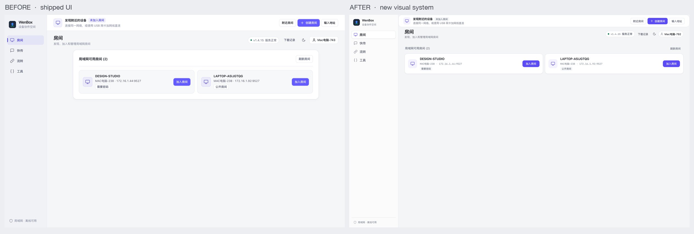

**房间（设备发现）**：去掉外层大卡与内层灰卡的双层结构；`auto-fit minmax(340px,1fr)` 网格让单房间占满整行、多房间并排。房卡 76px 高，房名 13.5/600 为主，`host · ip:port` 用等宽 10.5 弱化，状态徽章 18px；设备图标 38px 紫色软底；加入按钮 28px 品牌色；悬停只换边框与投影、不位移。空状态最大宽 380、居中，不含任何伪造数据。

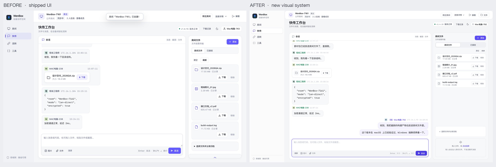

**快传工作台**：左主右辅双栏（`1fr + clamp(280px,25vw,330px)`，间距 10）。聊天区标题栏 47px；消息列表 16px 内边距、按人分组；气泡落在 `.chat-item_content`，12px 圆角、单侧 4px 尖角，自己为淡紫、对方为 surface-2 + 1px 边框；文件消息去掉气泡改为独立白卡（30px 图标 + 25px 下载按钮）；图片、代码块、复制按钮各有独立浮层样式。输入区 108px：58px 文本域 + 28px 发送按钮 + 24px 工具按钮，Enter 提示保留。右侧文件面板用 surface-2 辅助底、25px 分段控件、紧凑文件行（26px 图标 + 两行信息 + 23px 下载），归档区与拖放区固定在底部；拖放遮罩改为全窗 fixed + 模糊 + 内嵌虚线圈。

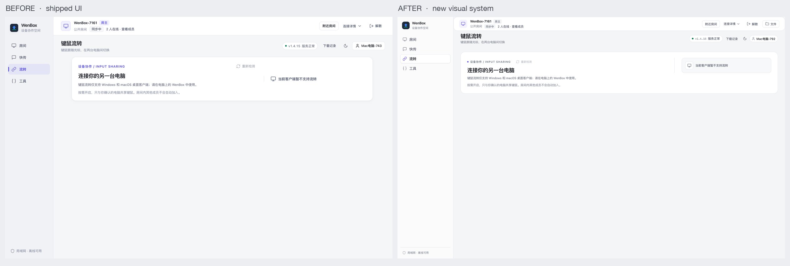

**键鼠流转**：Hero 两栏（说明 + 控制台，中间 1px 分隔线），标题 21px，状态徽章 24px；`需要授权` 使用琥珀色提示条；`屏幕与输入` 卡左侧 3×3 方位区（点阵底、虚线方向块、本机/对端屏幕），右侧 02/INPUT 指针与滚轮滑杆、预设、保存；配对、权限、按键映射、日志按需折叠。危险操作保留红色描边，但只占 2×2 控制网格中的一格。

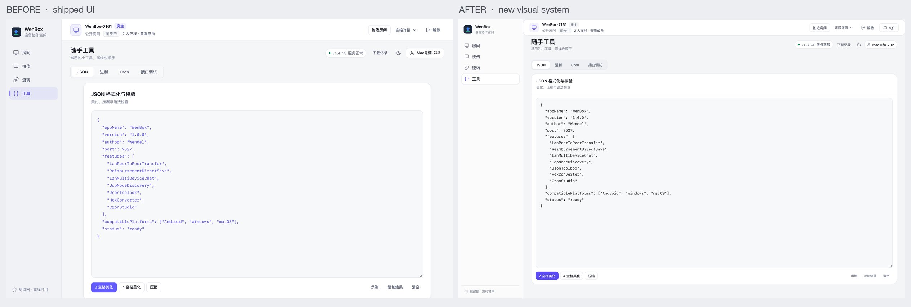

**随手工具**：页内分段控件切换四个工具，卡片去边框化。JSON 使用专业编辑器观感：等宽 12/1.7、surface-2 底、聚焦变白 + 紫色 ring、高度自适应视口（300–620）；操作区左「2 空格 / 4 空格 / 压缩」、右「示例 / 复制结果 / 清空」。进制转换每行 58px：标签 + 无边框数值输入（悬停/聚焦才显底）+ 26px 复制。Cron 两列（模板/表达式 + 含义/未来 5 次）。API 调试：折叠式「粘贴即填入」、方法+地址+发送请求条、Query/Headers/Body/认证/变量工作台与响应面板、历史记录；未新增任何接口能力。

深色模式与窄屏：

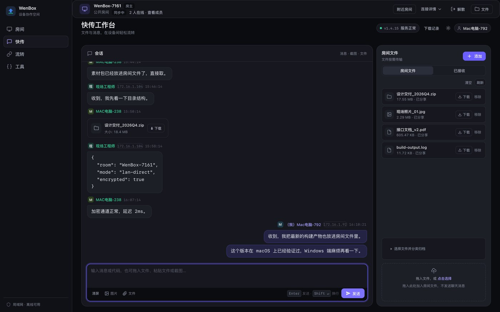
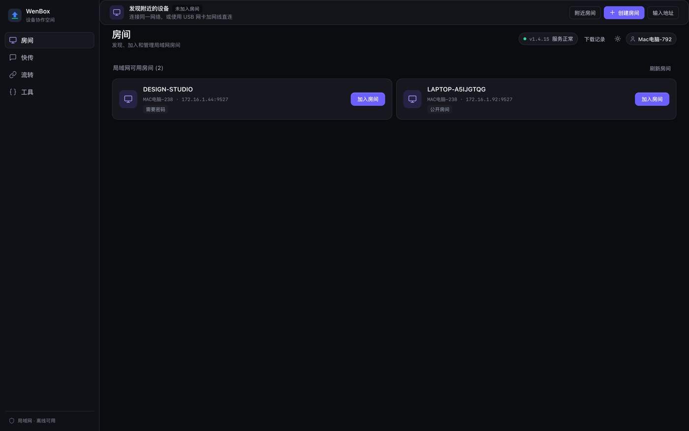
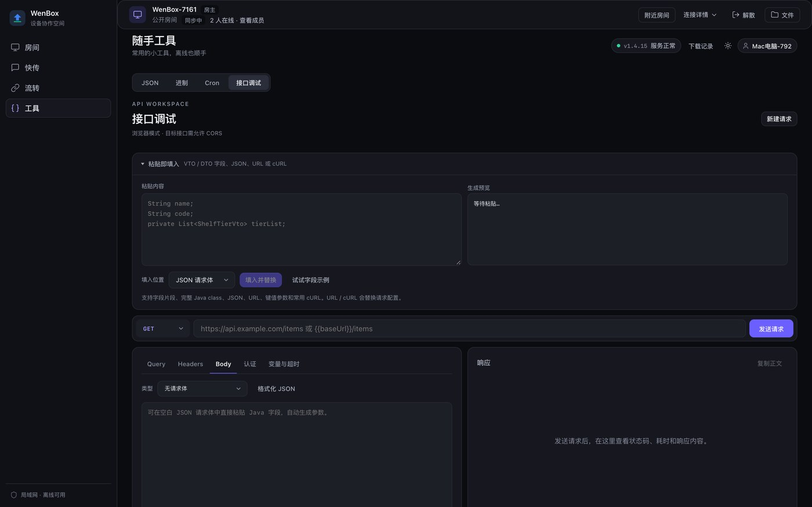
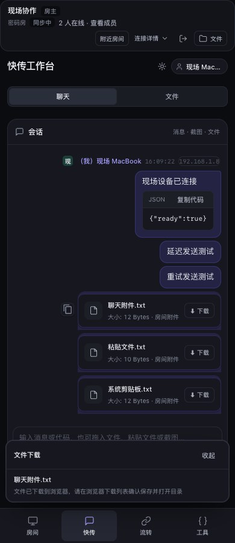
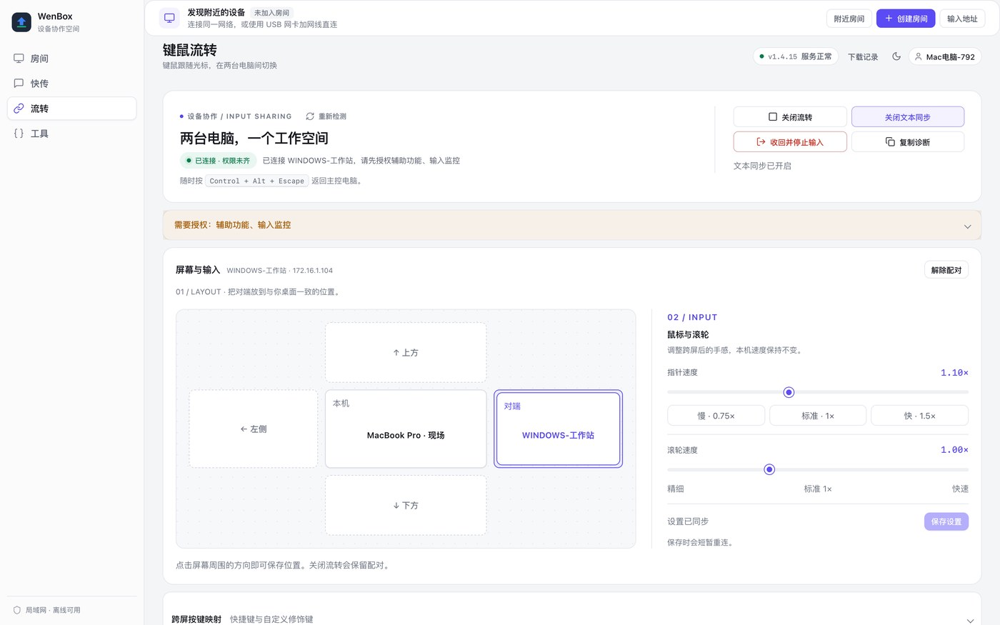

---

## 6. 文件修改清单

| 文件 | 变化 | 目的 |
| --- | --- | --- |
| `app/src/main/assets/web/tokens.css` | +125 / -62 | 重写浅/深两套调色板；补充 `--chrome-bg`、`--hairline`、`--rail-hover`、`--seg-*`、`--shadow-float`、`--scrollbar-*`、`--radius-*`、`--fs-3xs`、`--rail-w/--status-h/--header-h`；保留全部旧 token 名 |
| `app/src/main/assets/web/polish.css` | 整文件重写，现 2860 行 | 9 个分节：基础 / 外壳 / 控件 / 房间 / 快传 / 流转 / 工具 / 浮层 / 响应式；第二轮补充弹窗与浮层 |
| `docs/ui-redesign/*.jpg` | 新增 16 张 | 四页前后对比、深色、移动端、流转支持态，以及第二轮 6 张弹窗截图 |
| `docs/UI_REDESIGN_V2.md` | 新增 | 本报告 |

**未修改**：`index.html`、`app.js`、`kvm.js`、`ui-state.js`、`theme.js`、`upload-queue.js`、`demand-files.js`、`api-debug.js`、`src-tauri/**`、Android 原生代码、`package.json`、`package-lock.json`、路由与 IPC。

工作区中原本就有上一轮未提交的功能改动（`README.md`、`api-debug.css`、`app.js`、`demand-files.js`、`kvm.css`、`stream-crypto.js`、`src-tauri/src/demand_files.rs`、`scripts/check-web-ui.cjs`、`tests/stream-crypto.test.js`），本次未覆盖、未回滚；`tokens.css`/`polish.css` 是在其基础上的视觉层叠加。

---

## 7. 功能保护

- 所有业务选择器与 ID（`#view-*`、`#webChatMessages`、`#fileListContainer`、`#kvm*`、`#api*`、`[data-action]`、`[data-kvm]`、`[data-view]` 等）保持原样，只改外观。
- 事件处理、状态管理、请求、上传/下载、消息收发、JSON/进制/Cron 计算、键鼠通信、权限判定均未触碰。
- 两处「样式曾影响行为」的问题在验证中发现并修正，最终以 CSS 解决，未改 JS：
  1. 输入框的 `transition` 包含 `background`，导致 PIN 遮罩切换瞬间计算值仍是旧底色（回归断言失败）。已从过渡中移除 `background`。
  2. `workspace.css` 对 `.file-panel .section-header` 设了 `flex-direction: column`，与新版同行布局冲突。新样式显式声明 `row` 并补 `flex/min-width`，标题不再被压成 74px。
- 复制按钮改为气泡侧边悬浮，避免遮住图片的右键命中区；`.chat-img-overlay` 恢复 `pointer-events: none`。
- 浏览器回归覆盖：严格 CSP、创建/加入/退出房间、PIN 三态与 429 冷却、消息乐观发送/重试/头像、代码复制、仅元数据发布、房间与聊天拖放路由、重启身份恢复、下载、工具、平板抽屉、移动端分段、深浅主题截图。

**兼容性说明**：新样式使用了 4 处 `:has()`（文件消息去气泡、已发送列表为空时隐藏）与 `dvh` 单位。Chrome/Electron 完全支持；旧版 Android WebView 若不支持 `:has()`，只会有「文件消息保留气泡底色」这类纯外观降级，不影响功能；`dvh` 有 `--viewport-height`（`app.js:4549` 写入）兜底。

---

## 8. 验证与测试

### 8.1 已执行且通过

| 命令 | 结果 |
| --- | --- |
| `npm run lint:css` | **0 errors**，13 条 `style.css` 既有重复选择器警告（重构前即存在） |
| `npm test`（`node --test`） | **76 / 76 通过** |
| `node scripts/check-web-ui.cjs` | 通过（CSP、房间、PIN、消息、文件、下载、工具、平板/手机、深浅截图） |
| `node scripts/check-kvm-ui.cjs` | 通过（原生边界、发现/配对/确认、剪贴板、双滑杆保存、部分失败重试、轮询清理） |
| `node scripts/check-api-tools.cjs` | 通过（字段导入、真实 422、重复 query、历史、CSP、响应式） |
| `npm run build:api-tools` | 成功，产物与构建前 **逐字节一致**（未产生无关 diff） |

`npm test` 初次运行是 69/76，7 个失败全部为 `ERR_MODULE_NOT_FOUND: java-parser`——`package.json` 已声明该 devDependency，但本机 `node_modules` 未安装。用临时缓存安装后全部通过，`package.json`/`package-lock.json` 无改动：

```bash
npm_config_cache=/tmp/npm-cache npm install --no-save --no-package-lock --ignore-scripts java-parser@3.0.1
```

（默认 `~/.npm` 在当前沙箱不可写，必须换缓存目录。）

### 8.2 截图与视觉检查

- 基线：开工时就地渲染的 1440×900、1100×780、1024/768/390 截图（`/tmp/wb-probe-before`、`/tmp/wb-shots/before`）。
- 终态：同一 fixture、同一尺寸、深浅两套共 15 张（`/tmp/wb-probe-final`），另有 Electron 实机 5 张（`/tmp/wb-electron`）。
- 检查项：三行网格对齐、内容列居中、滚动条、悬停/聚焦、文字溢出、组件重叠、抽屉、移动端分栏、深浅对比度。期间修复了 toast 被拉伸成全屏、房间卡过挤、`已发送 0` 常驻、进制标签彩色滥用、KVM 重新检测按钮浮空、select 垂直内边距导致文字被裁、API 导入下拉宽度不足等问题。

### 8.3 Electron 实机验证（环境限制）

- 直接 `npm start` / `electron .` 在本沙箱失败：`ELECTRON_RUN_AS_NODE=1` 会让 Electron 进入 Node 模式（`ipcMain` undefined）；解除后 Chromium 又因无法写 `~/Library/Application Support/wenbox` 报 `sandbox initialization failed` 并触发 GPU 进程退出。
- 因此 `scripts/check-electron-ui.cjs` 在本环境超时失败（脚本本身未提供附加 flag 的入口，未修改该脚本）。
- 采用等价方式完成实机验证：Playwright `_electron.launch` 指向仓库内 Electron 44.8.0，附加 `--disable-gpu --no-sandbox --user-data-dir=/tmp/wb-electron-profile`，得到真实窗口 1100×748 @2x，逐页截图并读取 DOM 状态（`data-room-mode`、KVM `data-support`）。页面无 JS 异常，仅一条后端未启动时的 `ERR_CONNECTION_REFUSED` 健康检查（既有行为）。
- 键鼠流转在 Electron 中固定为 `unsupported`（原生桥只在 Tauri 下注入）。为验收支持态，使用 `page.addInitScript` 注入 `kvm_status` mock 后由**未修改的 `kvm.js`** 渲染，截图见 `ui-redesign/kvm-supported.jpg`。

### 8.4 未执行 / 无法执行

- 真实 macOS「辅助功能 / 输入监控」授权后的双机流转：需要 Tauri 桌面端与系统授权，本环境不具备；未伪造为通过。
- Android 真机/模拟器截图：环境无设备；本次未改 Android 原生布局。
- Windows 端视觉与高 DPI 实测：无 Windows 环境；CSS 使用逻辑像素与系统字体栈，未做平台特定假设。

---

## 9. 已知限制与后续建议

1. **KVM 未授权态留白较多**：浏览器/Electron 下只渲染 Hero 一张卡，页面下方为空。这是真实状态（不伪造内容），完整密度在支持态验证。若希望进一步收束，可为该状态增加一张说明卡（需要新增 DOM，超出本次「只改样式」范围）。
2. **移动端下载记录浮层**：打开时覆盖输入区（可点「收起」关闭），属于临时浮层；若需要完全避让，需让下载记录在窄屏改为页面内区块（涉及结构调整）。
3. **旧版 Android WebView**：`:has()` / `dvh` 为渐进增强，降级只影响观感。
4. 建议后续把 `style.css` 中仍被引用的旧组件规则逐步迁移进 `polish.css`，最终让 `style.css` 只保留布局骨架，减少覆盖层级。

---

## 10. 复现方式

```bash
# 桌面预览（本机需可用的图形会话）
npm start

# 浏览器回归 + 截图
PLAYWRIGHT_MODULE=<playwright 路径> \
BROWSER_EXECUTABLE="/Applications/Google Chrome.app/Contents/MacOS/Google Chrome" \
UI_SCREEN_DIR=/tmp/wb-shots/final \
node scripts/check-web-ui.cjs

# 样式与单测
npm run lint:css
npm test
```

视觉基线/终态截图与对比图位于 `docs/ui-redesign/`。

---

## 11. 第二轮增补（2026-11-16 下午）：弹窗、浮层与滚动

第一轮交付后，用户指出「弹窗太丑、还有没有优化到的地方、流转界面无法滑动」。第二轮只继续修改 `app/src/main/assets/web/polish.css`（2860 行），未触碰 HTML/JS。

### 11.1 流转页无法滚动（功能回归）

- **根因**：`<main id="view-kvm" class="primary-view kvm-view">` 是同一个元素；`polish.css` 中 `.primary-view { overflow: auto }` 被后面同元素的 `.kvm-view { overflow: visible; scrollbar-gutter: auto }` 覆盖，内容超出后被 `.app-container { overflow: hidden }` 直接裁掉。
- **修法**：删除 `.kvm-view` 的 `overflow` / `scrollbar-gutter` 覆盖，只保留 `display:flex; flex-direction:column; gap:10px; min-height:0` 与子项宽度规则，让 KVM 复用 `.primary-view` 的 `overflow:auto`。
- **验证**：支持态下 `#view-kvm` 计算样式 `overflow-y:auto`；展开「屏幕与输入 / 跨屏按键映射 / 键盘设置」后 `scrollHeight 1315 / clientHeight 784`，滚轮后 `scrollTop 531`，可滚到底部。

### 11.2 弹窗贴边、光环与留白的根因

- `app/src/main/assets/web/workspace.css:68` 用 `dialog.modal .modal-card { width:100%; max-width:none; padding:0; border:0; box-shadow:none; background:transparent }`（特异性 0,2,1）覆盖了 `polish.css` 的 `.modal-card`，导致内容直接顶到 16px 圆角外壳、分隔线贴边。
- 关闭按钮的紫色方框不是「样式」而是 `:focus-visible` 焦点环：对话框打开时焦点落在第一个可聚焦元素（关闭按钮）上。
- 错误详情是浏览器默认 `<details>` 三角 + 不换行 `<pre>`，长 URL 因此溢出。

### 11.3 本轮改动

| 区域 | 处理 |
| --- | --- |
| 弹窗外壳 | `dialog.modal .modal-card:not(.lightbox-card){padding:18px 20px 16px}`（0,3,1，压过 workspace.css）；灯箱单独 `padding:10px` 并恢复卡片底色 |
| 关闭按钮 | 28×28、8px 圆角；`:focus-visible` 改为 2px `--primary-soft-2` 细环，不再出现紫色方框 |
| 标题/正文/底部 | 标题 14.5/600、头 10px 下边距；正文 gap 13、说明 11/1.62；底栏 15/13 间距、按钮 12px |
| 房间预览 | 内边距 11×12、图标 34/r9、房名 12、副行 10；右侧标签改成白底 + 1px 描边的胶囊 |
| 手机扫码 | 二维码卡改为 `fit-content` 居中、10px 内衬、12px 圆角；URL 变成 mono 10px 的浅底 chip（可换行、最高 46px、内部滚动）；底部「完成」居中 116px |
| 解散/提示确认 | 正文 13/1.6、body padding 2px；卡片收成 430×184 的紧凑结构 |
| 在线成员抽屉 | 取消 `.modal-card` 的 84dvh 限高（`max-height:none`），关闭按钮用 `margin-top:auto` 顶到抽屉底部 |
| 下载记录 | 头部/回执内边距与字号上调；错误详情自绘小三角（展开旋转 90°）；`pre` 改为 `pre-wrap + overflow-wrap:anywhere`，最高 108px 内部滚动 |
| PIN 输入 | 六格改为 `repeat(6, minmax(0,1fr))` 等宽；隐藏覆盖层输入框的边框与 placeholder，消除「双框 + 占位文字压格子」 |
| 复制反馈 | `.copy-btn.copied` 由 22px 方形改为自适应宽度的「已复制」胶囊，修复文字竖排溢出 |
| 图片消息 | 缩略图容器补 `min-width:96px; min-height:64px`，加载失败时不再塌成一个小图标 |

### 11.4 截图

| 弹窗 | 截图 |
| --- | --- |
| 加入房间 | 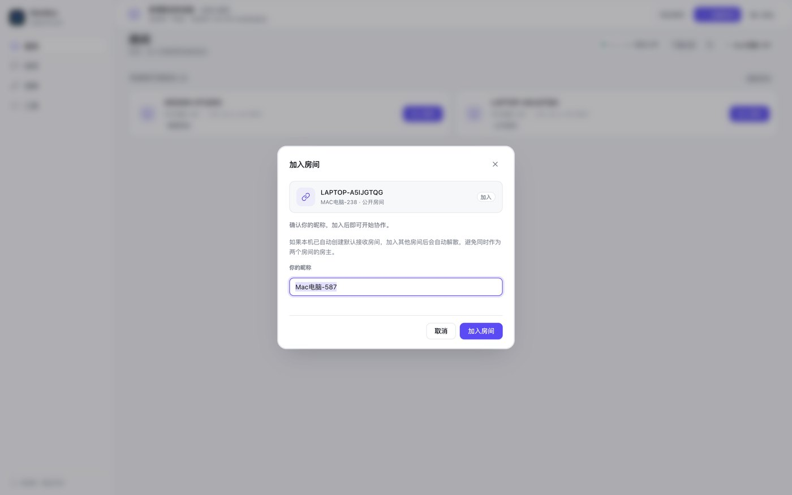 |
| 加入房间（PIN） | 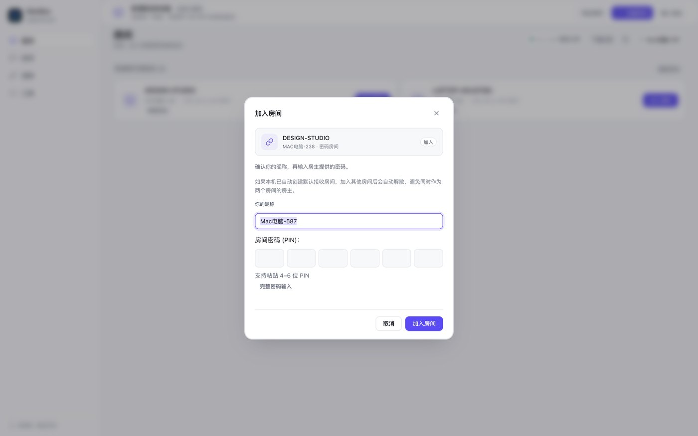 |
| 手机扫码 | 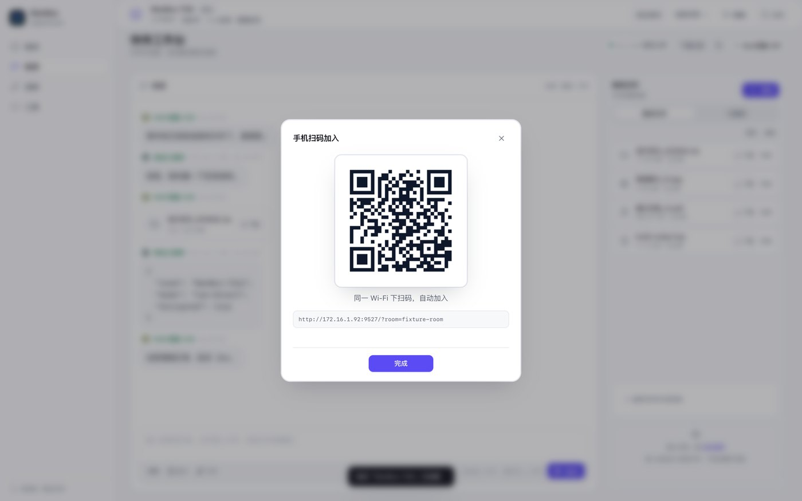 |
| 解散确认 | 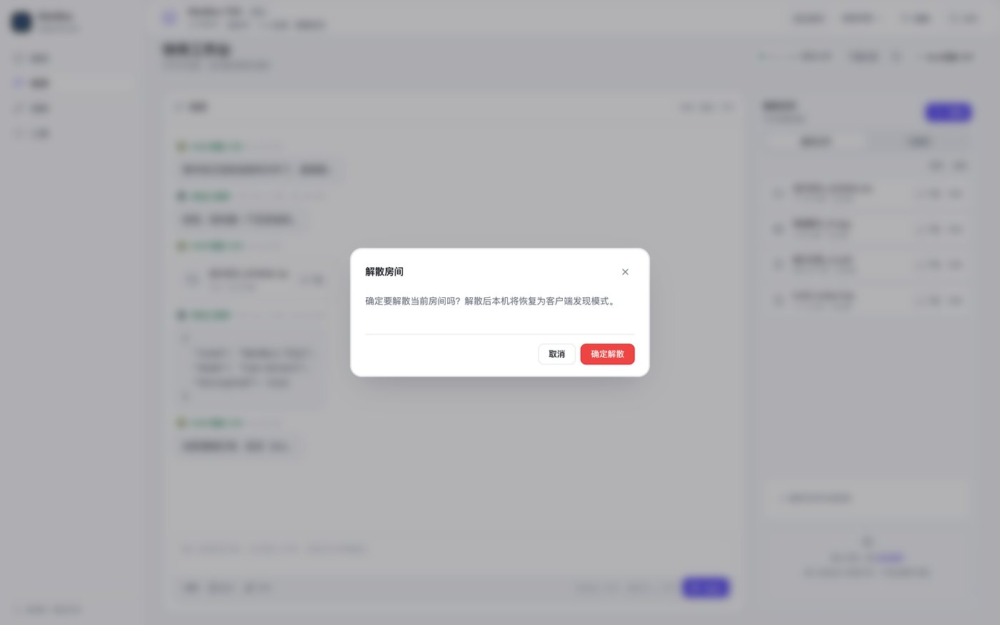 |
| 下载失败详情（展开） | 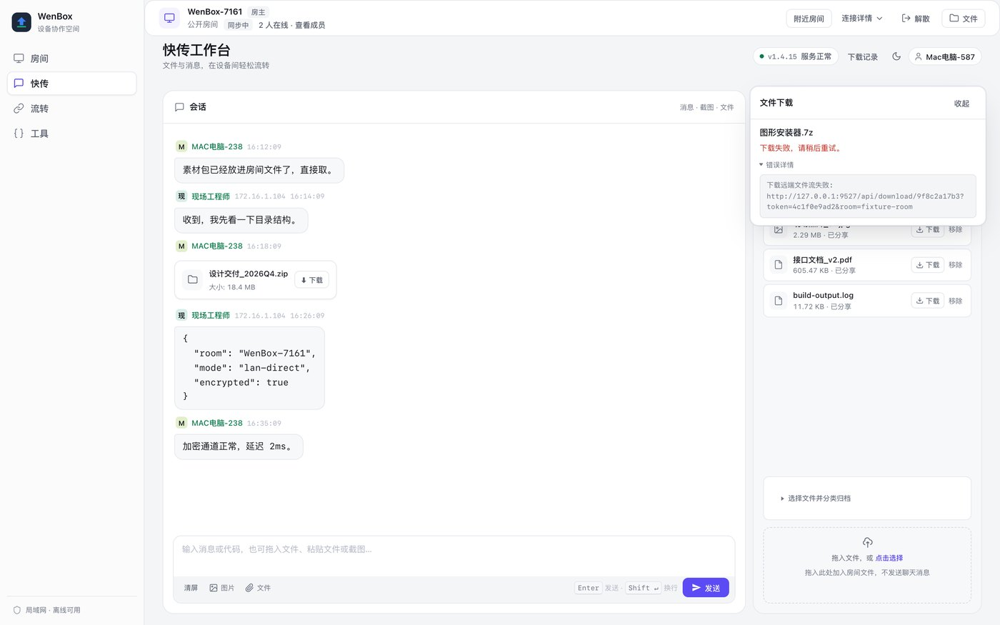 |
| 移动端底部抽屉 | 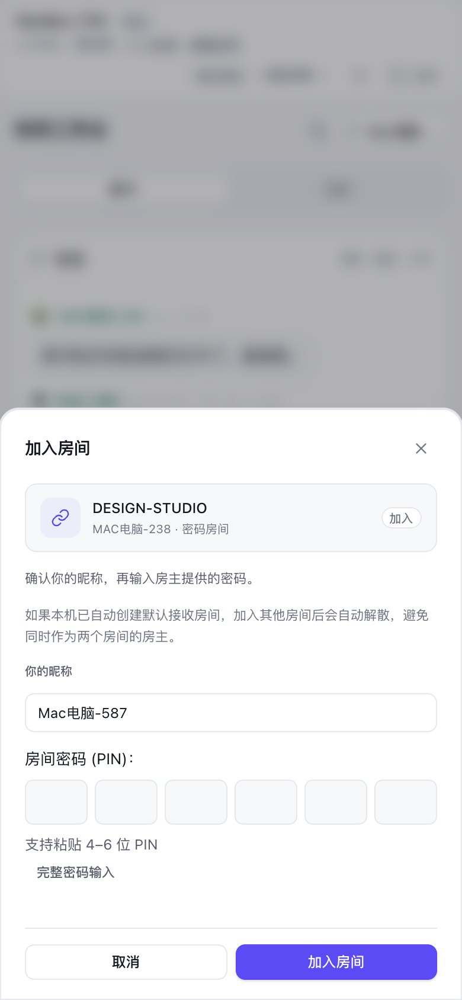 |

### 11.5 再次验证

| 命令 | 结果 |
| --- | --- |
| `npm run lint:css` | **0 errors**，13 条既有警告（与第一轮相同，未新增） |
| `node scripts/check-web-ui.cjs` | 通过（含 PIN 覆盖层、复制按钮、右键菜单、下载、平板/手机、深浅截图） |
| `node scripts/check-kvm-ui.cjs` | 通过 |
| `node scripts/check-api-tools.cjs` | 通过 |

说明：本轮修 `.copy-btn.copied` 时曾把按钮改到气泡上方，结果 22px 按钮盖住 16×16 的测试图片、导致图片右键菜单断言失败；最终改为气泡侧边悬浮（`left/right: calc(100% + 6px)`）并补回 `.chat-img-overlay { pointer-events:none }`。PIN 断言曾因输入框 `transition: background` 在类切换首帧读到旧值，已移除该过渡属性。
